# Grandpa Lee’s Wee Book of Fun

This guide provides memories, technical details, route information, and personal insights for several high-quality adventures across the world.

## The backyard

6253 Adobe Dr, San Diego California, was a wonderful place to spend a childhood. The neighborhood has changed a lot since the 1970s. There are giant parking structures, accessory apartments in every backyard, and SDSU has built on every available spot of land. However, the basic feel of my playground is still there.

Notable features include:

- Backyard. Filled with an orchard of trees. Avocado, tangerine, lemon, plum, and even a fig tree. This was the site of campouts, games of croquet, tree climbing, and even a couple small fires.
- Playground. I spent hours playing in the small backyard canyon. Wandering, exploring, build forts, playing tag, and tending my cucumbers in the small garden.
- Skateboard Ramp. Coming steeply of Montezuma Ave this was the dare devil trick. Ride your skateboard down the ramp. If you were daring you would do it catamaran style with a buddy sitting on two boards with legs connecting you both.
- Kite flying lot. Before they build the big garages in the 1990s this was a huge parking lot that was empty on weekends and evenings. We had to cross this to get to 7-11 for our slurpees. One of my favorite memories was flying kites here since it was so open.
- Fuller's Pool. Endless summer days playing silent (a variate of marco-polo where you don't make any noise and try to score points by tagging the person who is it) and trying to improve my diving.

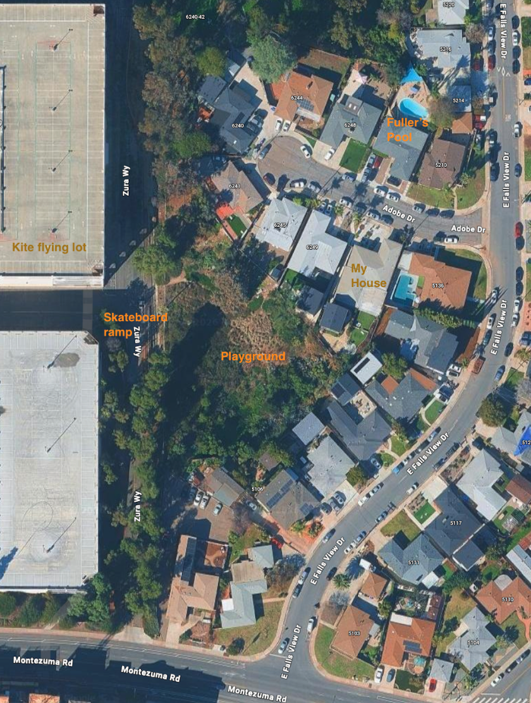

## San Diego State University

We we got tired of playing around our house Karl and I often wandered over onto San Diego State University's campus. We went everywhere. We knew every little path, vending machine, and bathroom. Some of our favorites included:

- 7-11 - Frequently visited for slurpees and candy bars
- Arcade - Hours spent living the 80s dream of playing Pac-man, Galaga, Donkey Kong, and Spy Hunter.
- The grates - For a hundred yards there were metal grates that ran along a covered path. These often contained quarters that we could pull out for the vending machines.
- Concerts - The Kinks, Echo and The Bunnymen, The Smiths, and many others. During the day you could sneak in and pretend you were a rock star on stage.
- Tag Playground - AKA the library. The five story elevators were a great addition to our many games of tag.
- Theater - Mom often brought me here to enjoy the arts.
- Skating Run - This hillside garden has a great slope that we would take a full speed on our roller skates.
- Bell Tower - The quad in front was a favorite place for our shooting games with disk guns. Once a professor yelled out the second story window for us to be quiet. It turned out to be our dad! One time they left the tower unlocked and we got to climb up inside.
- Dad's office - A common hangout where we got to be with dad in his office or lab.

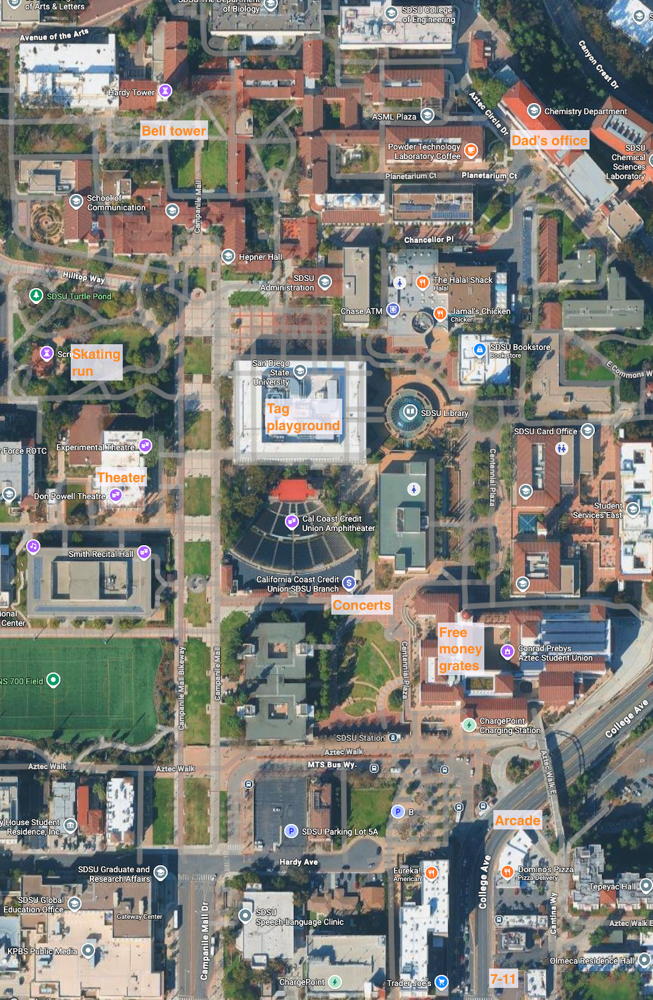

## Adobe Falls

Just north of our house the San Diego River "flows" through Mission Valley. This was a little stream that diverts underneath I-8 as it tries to get to the ocean. We often went through the tunnels and had adventures. Once I took the deacons there for a scout hike just before I was ordained a deacon. Being a little too carless as I showed my friends how cool it was to have this hidden path right in my backyard, I slipped on a bit of gravel and went face first down a 8 foot rocky cliff. This ripped of a significant portion of my face and required lots of stitches and I still have scars. We hiked up to the freeway where my brother Milo picked me up and took me to the hospital. That Sunday I passed the sacrament for the first time and I sure made everyone sick as they grabbed the bread from the tray.

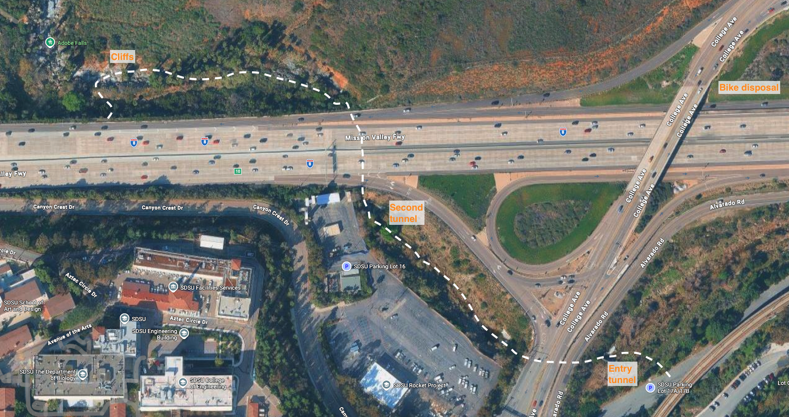

## Lost in the Sierras

1978 I finally go my chance to go on a Sierra Trek with my family. Up until then it was always my older brothers that came back with tells of adventure and conquest. But at the ripe old age of eight I was deemed worthy. Much of the details are lost to time but we entered from the Eastern Sierras by Mammoth. We spent our first night at Shadow lake (blue dot). The next morning my older brothers were up and ready to get on the trail so they could go fishing. Mom and dad were still working to clean everything up and so they let me go with the big boys. I was slow and so it wasn't long before I was lagging behind. My brothers thought my parents were right behind us and so they figured I would be fine. I made wrong turn and headed to Ediza Lake instead of Garnet (Green dot) Lake. I was moving as quick as I could on my little legs, but when I got to Ediza Lake (red dot) and saw the name I knew I was in the wrong place. I did see some campers on the other side of the lake and so I crawled over the rocks on the northern shore hoping that I was wrong about the name of the lake. Unfortunately, my family was no where to be found. Then it started raining. A nice man let me put my pack in his tent and told me to go sit on a big rock. I sat there and cried for a long time. Eventually I saw Doug coming over the rocks and knew that I was saved. He grabbed my pack and even gave me a piggy back ride over the pass to Garnet Lake where my parents were greatly relieved that I was found.

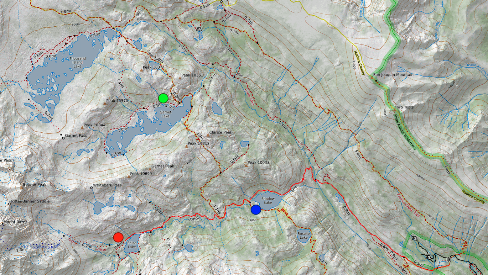

## Orderville Canyon

- Length: 10-12 miles
- Time: All day
- Difficulty: Main Canyon - 2B with 10 foot downclimbs. Birch Hollow start - 3A with 100' rappels.
- Comments: Permit required for Overville. Birch Hollow is on BLM land. Bring a 20' root for the main canyon, optional harnesses for the timid. Birch Hollow, full canyoneering gear.

I have been in Zion's Orderville Canyon dozens of times and it is one of my favorite places in the world. My earliest memory is when my dad and older brothers made a decent from the East Mesa all the way to the exit of the Narrrows. Karl and I were too young at the time and so mom led us up to were Orderville intersected with the Narrows and then to where the first obstruction was. I remember looking at those massive canyon walls and the cliff that blocked the way and wondered if my brothers would ever make it down. This was the early 70s and Orderville was not very well known at the time. No permits, no guides, no internet to tell you how to do it. No trailhead to park at. No signs saying where the canyon actually was. My dad was amazingly adventurous to have done it then. I believe he went to the hardware store and bought a short rope and then had a hard time figuring out how to get into the canyon.

Since that first view of the canyon I repeated the trip with my brothers, with Lisa shortly after we were married, church groups, my family, and extended family. Every time was a new adventure as it can greatly vary based upon how much water and mud there is in the canyon. With a long 10 mile hike, and some moderate technical obstacles, it is great for a variety of skill levels.

The Birch Hallow entrance makes for a nice technical start with multiple rappels up to 100 feet. I strongly suggest you skip the first two raps by going around them on the left.

If you don't have a permit for Orderville you can go back up Orderville canyon to the parking area. This is a long sun baked slog. There is also a trail, that has become popular staring in the early 2020s, that cuts up the hill on faint trails back to the Birch Hollow parking area.

This is a required trip for those who want to be true Jensen Hikers.

[TopoMap](https://caltopo.com/m/50NTFBH#)

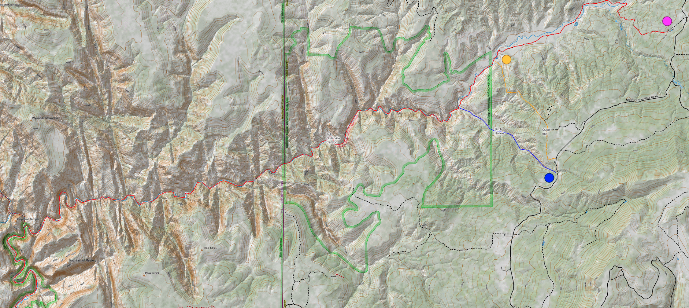

## Lady Mountain

- Length: 3 miles
- Time: 5-6 hours
- Difficulty: A few moves of 5.6.
- Comments: No permit required. Lots of elevation gain (~2500 in a mile). Bring a 20' root to belay the short technical sections. The crux 5.6 move is exposed but easy. The wall 5.6 move is harder, a bit longer, but not exposed at all. Very hot in full sun. Avoid it if there is snow on the trail. The slabs above 5.6 wall and just before the summit can be very slippery if wet.

Back in the 1960s Lady Mountain was one of the most popular "hikes" in Zion. It is located right across from the lodge and use to have chains and ladders to tame the exposed parts. It was common for people to race to the top while their friends watch through telescopes form the lodge. After a couple fatalities and too many rescues the park service removed the chains and ladders and took it off of the park maps.

Today, you can hike Lady Mountain without a permit. It is a wonderful hike that is very accessible and dramatic. It is very unlikely that you will see another party on the route.

This was one of my first memorable hikes that I did with my dad and my brothers. I was probably about seven years old. After drinking all of my water, Marc gave me some of his, but taught me how to take a sip, swish it around in my mouth to satisfy the dryness and the gulp it down. Milo has a famous story about dad encouraging him to the top by telling him there was an apple tree at the top (dad had an apple in his pack for him). Milo didn't buy it and refused to go to the top, but this was the origin for the "There is a slurpy machine at the top" motivational encouragement for struggling hikers.

This is a required trip for those who want to be true Jensen Hikers.

[TopoMap](https://caltopo.com/m/50NTFBH#)

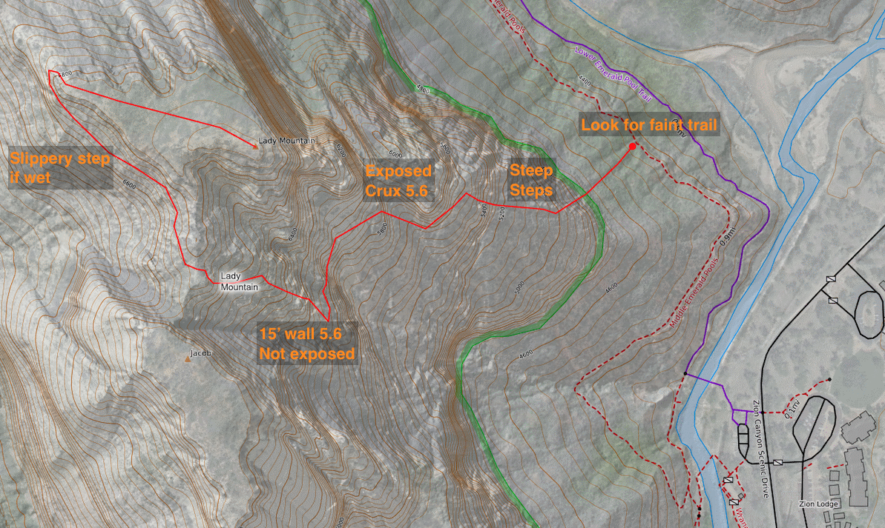

## Mt San Jacinto

- Length: 15-20 miles
- Time: multiday
- Difficulty: +3000k elevation gain on well maintained trails
- Comments: I believe you need a permit for this now days. Both for the summit and overnight camping.

By the time I was old enough to do overnight backpacking (around 1978) mom and dad would take Karl and me up Mt San Jacinto which as a couple hour car ride from San Diego. Located between Riverside and Palm Springs it is a beautiful and accessible peak. In fact Palm Springs operates a tram that will take you most of the way up to the summit. We would hike up and spend the night above the steep initial switchbacks and then hike the peak the next day. I have great memories of these trips as being difficult but something I could feel good about accomplishing.

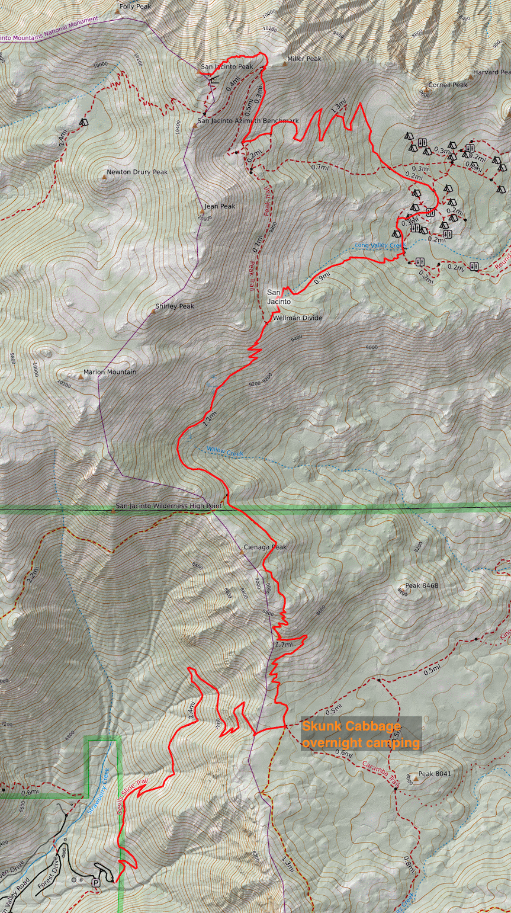

## Palomar 6th Grade Camp

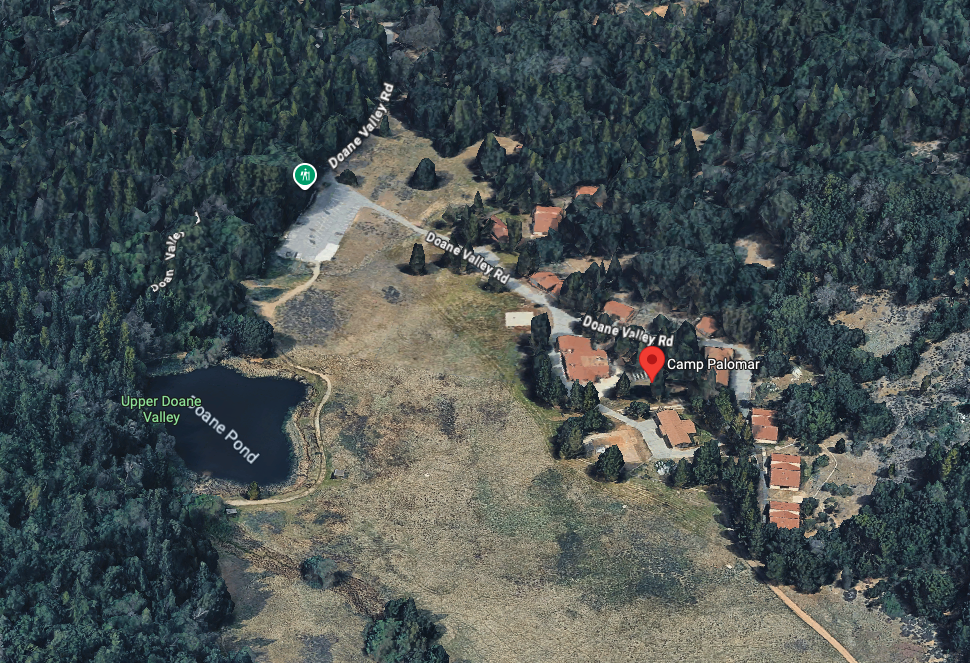

In 1981 I spent a week up at the school's sixth grade camp. It was fun to be outdoors, but awkward to sleep in a cabin with all of my classmates at a time of life where it was tricky to fit in. The best part of it was that Milo worked there as a cook and he would come and tell ghost stories to our cabin every night.

The camp is now closed down, but I still think about it with semi-fond memories.

## The Across America Road Trip

## Alaska Road Trip

## Lake Powell

## Europe with Reilly and Eleanor

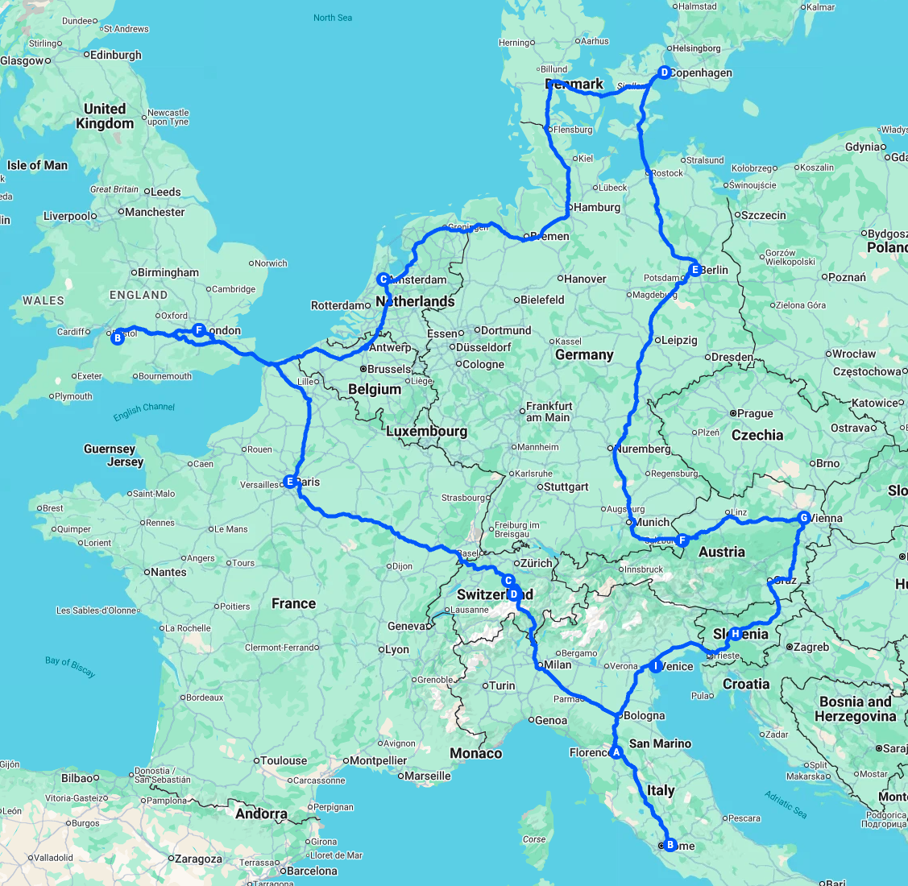

## Colorado River: Hoover Dam to Lake Mohave

A week-long canoeing trip starting immediately below the Hoover Dam.

- **Launch:** Access requires special permission to use the road below the dam.
- **Conditions:** The water is fast and cold for the first day.
- **Hazard:** Strong upstream winds can occur as the river widens near Lake Mohave, which can significantly stall progress if paddling in the middle of the river.

## Backpacking Europe

My senior year of high school I left a few weeks early so that Karl and I could get a cheaper flight to Europe. Our plan was to use a Eurail Pass to backpack around the continent staying in youth hostels.

It was a fantastic trip that really built my confidence to see the world. Karl was an amazing traveling partner as he put up with my non-planning and impulsiveness.

Things started on a sour note when we arrived in London and found that we needed reservations in order to stay in the hostel there. So we made reservations for our return leg and took off for Brighton and then across the channel to Paris. After that we still had lots of obstacles, but we saw so many amazing things and just enjoyed ourselves with the freedom of our travel.

I really didn't know what I was doing at it showed when we tried to go to Tours (because that is where the Tour de France was located) but even messed that up since we didn't know how to translate place names to French and ended up on a train to somewhere else.

The only reason we went ot Cologne was because I liked men's perfume. Why we didn't go to Rome was because I had already been there. Never-mind that we could have easily rented scooters and drove all over the place. We went right by Luxembourg, Brussels, and Liverpool and didn't bother to stop in. I also failed to take Karl to Berlin where the wall was still standing and he would have really enjoyed seeing that.

All I can say was this was before the internet and so there wasn't really a way to easily plan. The guide book we did take with us only pointed us to really crowded tourist traps and the book got stolen in Munich anyway.

We lived so cheap. Maybe a little too cheap. Hostels were $5 a night and we ate out of grocery stores almost the whole time.

I would love to do a trip like this again.

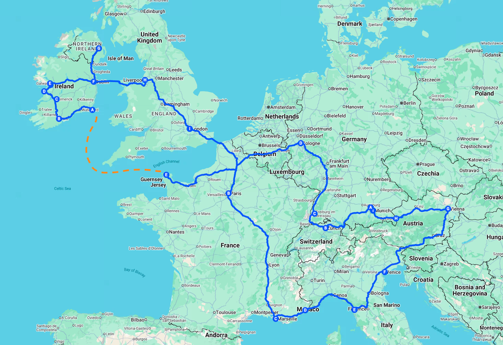

## Grand Canyon Rafting (Full Length)

A motorized raft expedition from Lee's Ferry through the length of the Grand Canyon.

- **Duration:** Typically 8 days.
- **Logistics:** Commercial trips often include transportation from Las Vegas to the launch point below Glen Canyon and a jet boat pick-up at Lake Mead.
- **Regulation:** The National Park Service strictly enforces a "one trip per year" rule for the Grand Canyon.

## Bridalveil Falls

Shortly after Lisa and I were engaged, she went off to Belgium for the summer. It was the summer of loneliness for me and I mostly just worked. However, one day a few of my friends suggested we go see Bridalveil Falls in Provo Canyon. It was a nice day and the falls were beautiful. We found a trail that took us around the side of the lower falls and to the upper falls.

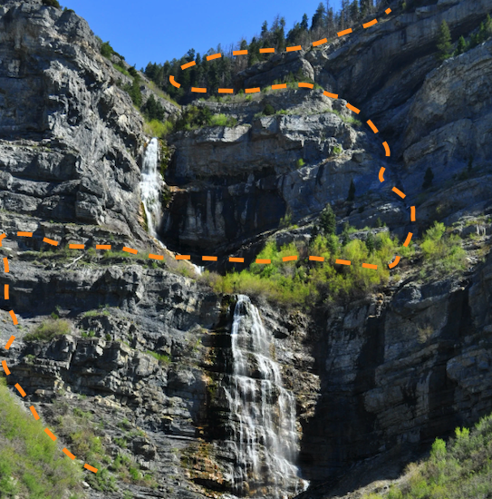

By myself, I wandered further around the right side of the upper falls wondering if there was a way to get to the very top. I saw what looked like a way that a would go if I climbed up a slab of rock and so I went for it. Halfway up the rock was wet and I realized that it would be very difficult to go back down. I had no choice but to keep going. I thought maybe I could hike around the backside. I later learned that that would have been a 15 mile hike.

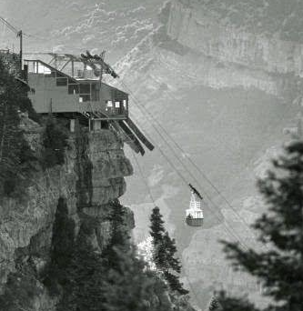

However, there was also a tram, back then, that went to a restaurant that was perched on the side of the cliff. The were kind enough to give me a ride to the bottom. I remember thinking while I was sitting on that cliff that Lisa is going to be so mad at me if I die. From that day on, I have been **very** careful about the risks and adventures I take.

## Angel's Landing

## Ontario Road Trip

## Puerto Rico - Rincon

## Jamacia - Negril

# 2001 - 2010

## French Riviera

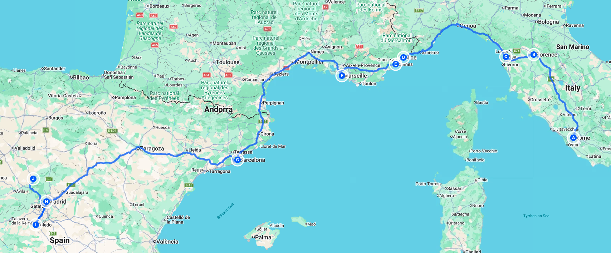

## Hong Kong

## Puerto Rico - San Juan

## Hawaii 1

## Hawaii 2

## Zion Traverse

# 2011 - 2020

## Ireland - Ring of Kerry

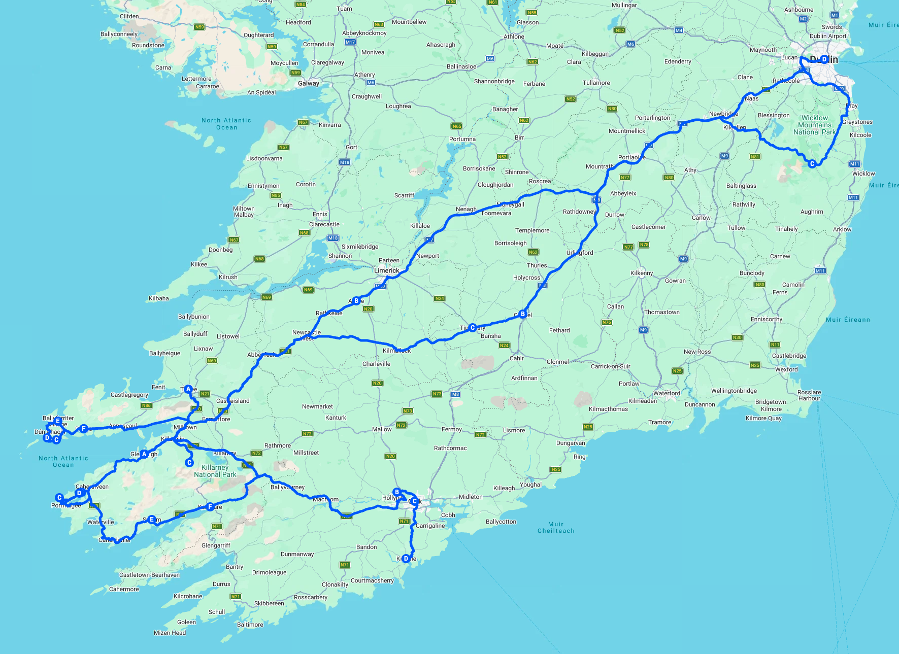

## Ireland - Cliffs of Moher

## France, Luxembourg, and Belgium

## Hawaii 3

# 2021 - 2030

## Alaska Cruise

## Ireland - Beara Trekking

## Italy

## Guadaloupe

### Leprechaun Canyon (North Wash, UT)

Leprechaun consists of three distinct forks. It is recommended to descend them in the order of Right, Left, and then Middle.

**Approach (Common to all forks):**

- Hike up the canyon from the trailhead for approximately 20 minutes until you reach a major side canyon on the left (LUC).
- Ascend the rib between the side canyon and the main canyon to reach the rim (4th class scrambles).
- Follow the trail around the rim to the head of your chosen fork.

| Fork            | Difficulty & Character                       | Key Technical Obstacles                                                      |
| :-------------- | :------------------------------------------- | :--------------------------------------------------------------------------- |
| **Right Fork**  | Moderate introduction; tends to hold water.  | 15m (50ft) initial rappel; final 10m (33ft) rappel into the main fork.       |
| **Left Fork**   | Short and interesting; very narrow sections. | 8m (27ft) initial drop using a wedged rock in a pothole as an anchor.        |
| **Middle Fork** | Most difficult and narrow; gear-intensive.   | 6m (20ft) low-angle rappel and a final 4m (14ft) drop into a potential pool. |

### Behunin Canyon (Zion National Park, UT)

A classic Zion technical canyon best enjoyed with an early start to manage heat.

- **Strategy:** Start between 4:00 AM and 7:00 AM to stay in the shade during the initial hike.
- **Weather/Safety:** Flash flood danger is relatively low compared to other Zion canyons due to limited drainage.
- **Conditions:** The upper series of rappels can be windy and chilly even on warm days.

## Desertarama I (San Rafael Swell, UT)

A multi-day adventure focusing on off-road riding and canyoneering, typically late May.

- **Key Locations:** Devils Racetrack, Goblin Valley (Color/Back of the Reef trails), Robbers Roost, Blue John Canyon (East/Main forks), and Lost Spring Canyon.
- **Gear:** Technical canyoneering gear (rope, harness) is required for slot canyons. Standard camping gear and ample water supplies are essential.

## Brighton to Provo

## Mt Olympus

## Twin Peaks

## Nebo

## Santaquine

## Spanish Fork

## Provo

- Distance: 10 miles RT. 2 miles RT starting from the road.
- Elevation gain: 6200'
- Comments: The final ridge is steep as it is a typical Wasatch direct trail to the top. Much easier if you start on the Squaw Peak road (only 2 miles total).

There are many different ways to do Provo Peak. The first time was with Sam and Mckay. We drove up the Squaw Peak road and camped the night. In the morning we did the steep slough up to the summit. I didn't know where the trail was and so we just went right up the ravine until we finally met up with the final ridge trail. Sam was not feeling well, but both of my hiking buddies made it to the top. It was quite an accomplishment for them and I was proud. Going back down we followed the trail the whole way.

Since then I have done Provo Peak via the Triple Crown. Starting at Big Springs in the South Fork of Provo Canyon, up to Cascade saddle, to Freedom Peak, then East Provo Peak, and then finally Provo Peak before descending down through Slate Canyon.

Dillon, Caleb, and also did it from the Bonneville Shoreline Trail via the Y trail. That is a long hard hike. Lots of elevation gain with some up and down as you wrap around Lions Head. We made it even longer by coming down Slate Canyon. This added an additional mile. If you are feeling strong, this is actually a pretty enjoyable way to do the hike.

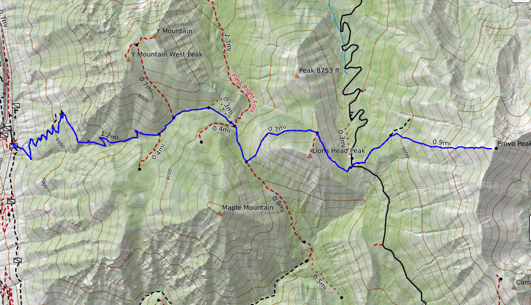

## Cascade

## Timpanogos

## Lone

## Sierras During a Fire

## Caribbean Cruise

## Grand Teton

## Wind River 100 Year Storm

## Wind River Traverse 1

## Wind River Traverse 2

A premier high-altitude trek covering approximately 80 to 100 miles through the Wind River Range.

- **Optimal Timing:** Late July to mid-August.
- **Route:** Roughly follows the reverse of the Wind River High Route, crossing the continental divide multiple times.
- **Typical 8-Day Itinerary:**
  - **Day 1:** Depart Provo (5 AM); hike 9 miles into the Cirque of the Towers.
  - **Day 2:** Rest day in the Cirque.
  - **Day 3:** 16 miles to Middle Fork Lake.
  - **Day 4:** 13 miles to Upper Golden Lake.
  - **Day 5:** 11 miles to Indian Basin.
  - **Day 6:** Optional ascent of Fremont Peak or rest day.
  - **Day 7:** 12 miles to Three Forks Park.
  - **Day 8:** 12 miles to Green Lakes trailhead.

## Triple Crown

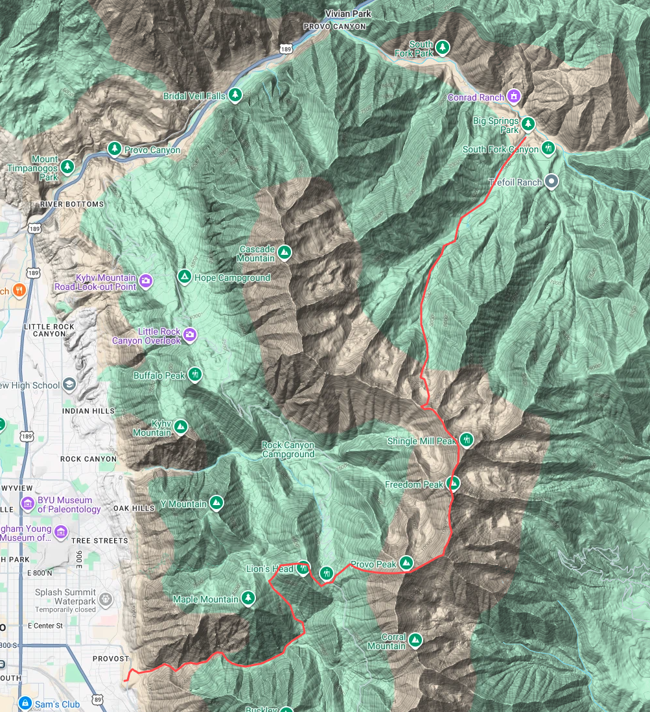

## Y Mountain

## Buckley Mountain

Distance: 2 miles
Elevation gain: 1000'
Comments: Nasty bushwhack. Solitude.

Buckley Mountain was the last small peak along the Provo Front and so when Doug suggested we drive the Squaw Peak Road I said I would do it if I could take a quick side hike to the top of Buckley Mountain. The alternative is to start on the Bonneville Shoreline Trail and hike 2 miles, one way, with 5000' of elevation gain. I thought this would be easy.

What we found was a steep approach covered with impassible scrub oak. Literally climbing on top of the scrub and pulling branch to branch I made it to the ridge covering only a quarter of a mile in a half an hour. Once on the ridge it was a quick run to the summit. Maybe the valley approach would have been more enjoyable, but I don't feel any compulsion to do it again.

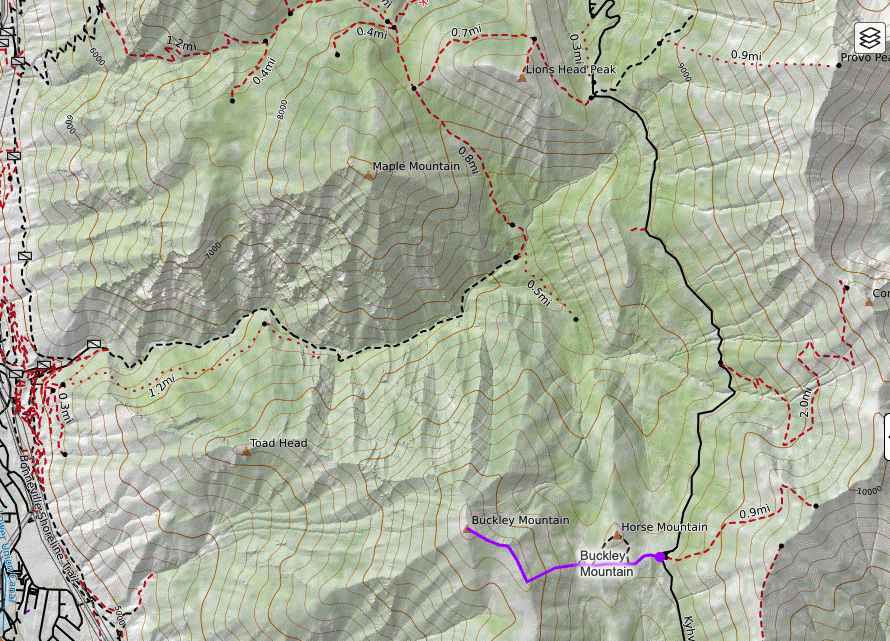

## Maple Mountain

Distance: 5 miles
Elevation gain: 3800'
Comments: Great hike if you want solitude. Beautiful views. Hard scrambling after Maple Flats. Maple Flats would be a good place to camp.

After looking at Maple Mountain from our backyard for 15 years I talked Mckay into hiking it with me. We took the Y trail up to slide canyon and then up to maple flats. There isn't really a trail to the top and so we just went up the NorthWest ridge. It was steep bushwhacking but eventually we got to the top. The view is great from the summit with views looking down into Slate Canyon, out into the valley, and Y mountain to the north.

We took longer than expected coming up the ridge and it was getting late and so I thought we could save time by going straight down the mountain to the Bonneville Shoreline Trail and then home. However, the gully that led down from Maple Flats was filled with Scrub Oak that make for slow going. Plus Mckay likes to take it extra careful going down steep slopes, and it was steep, so the sun was quickly setting as I urged Mckay on and we reached the trail with the sunlight completely gone. I think we might have gone faster if we had gone back the way we came.

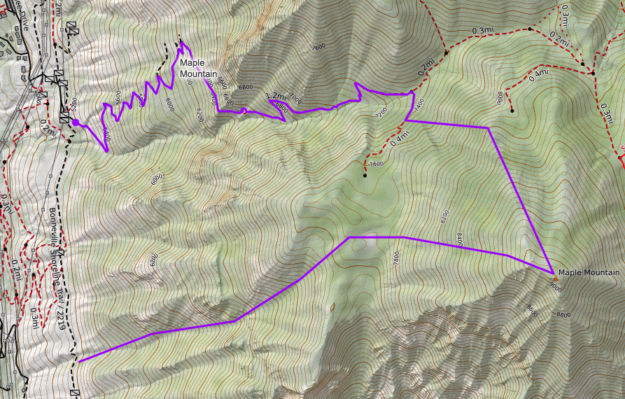

## Uinta Highline 1

## Uinta Highline 2

## Uinta Brothers Trek

## Uinta King's Peak

A 43-mile high-altitude trek in the Uinta Mountains, typically involving 3-4 days.

**Strategy:**

- **Approach:** Drive to Swift Creek Campground.
- **Typical 4-Day Itinerary:**
  - **Day 1:** Drive to trailhead, hike 15 miles to base camp in Yellowstone Basin.
  - **Day 2:** Summit Kings Peak (10 miles, 3000' gain).
  - **Day 3:** Hike 10 miles via Bluebell Pass, camp near Farmers Lake.
  - **Day 4:** Hike out 7 miles and drive home.

## Tower Climbing

| Route           | Grade | Length      | Notes |
| :-------------- | :---- | :---------- | :---- |
| **Castleton**   | 5.9   | Multi-pitch |       |
| **Ancient Art** | 5.7   | Multi-pitch |       |
| **The Priest**  | 5.8   | Multi-pitch |       |

## Red Rock Canyon (Nevada)

| Route             | Grade | Length      | Notes                                            |
| :---------------- | :---- | :---------- | :----------------------------------------------- |
| **Solar Slab**    | 5.6   | Multi-pitch |                                                  |
| **Tunnel Vision** | 5.7   | Multi-pitch |                                                  |
| **Dark Shadows**  | 5.8   | Multi-pitch | Recommended warm-weather option with good shade. |

# St. George Region (Utah)

**Snow Canyon State Park Hiking:**

- **Jenny's Canyon:** Short, scenic canyon walk.
- **Hidden Pinyon:** Informative desert trail.
- **Red Sands:** Deep sand trail through red rock scenery.

**Bicycle Routes:**

- **Virgin River South Loop:** Ideal for road cycling in the St. George area.

## Pittsburgh East Coast Drive

## The AlCan Highway

## Alaska Inner Passage

## Utah National Parks - Ritika

## New England Tour

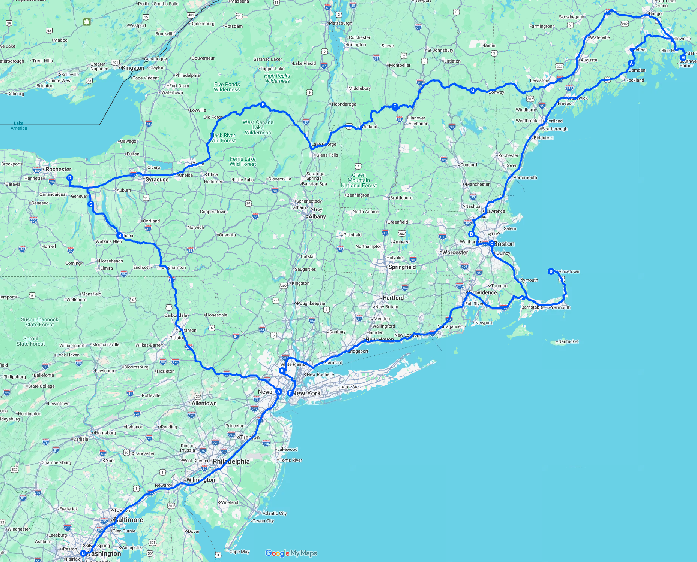

## Wyoming and South Dakota

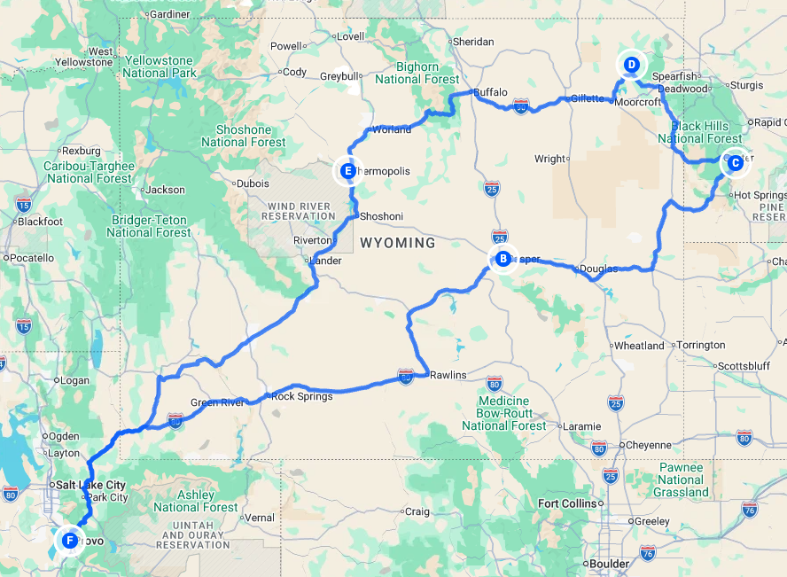

A multi-day trip with the following itinerary:

1. Day 1: Provo to Wyoming (5 hours)
2. Day 2:

## Colorado Tour

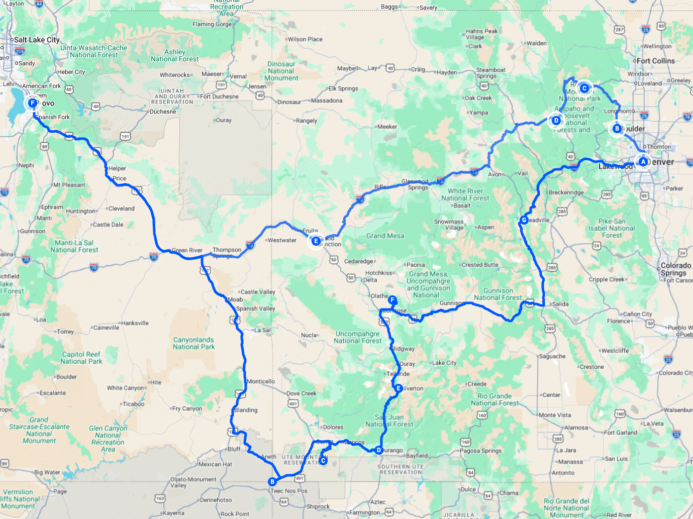

## Brothers Tour

## Washington Tour

## Arizona Tour

## Carolinas Tour

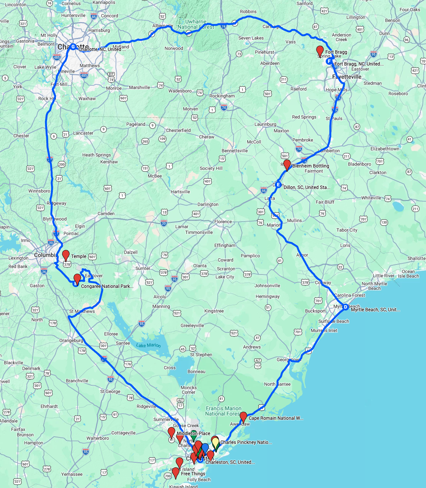

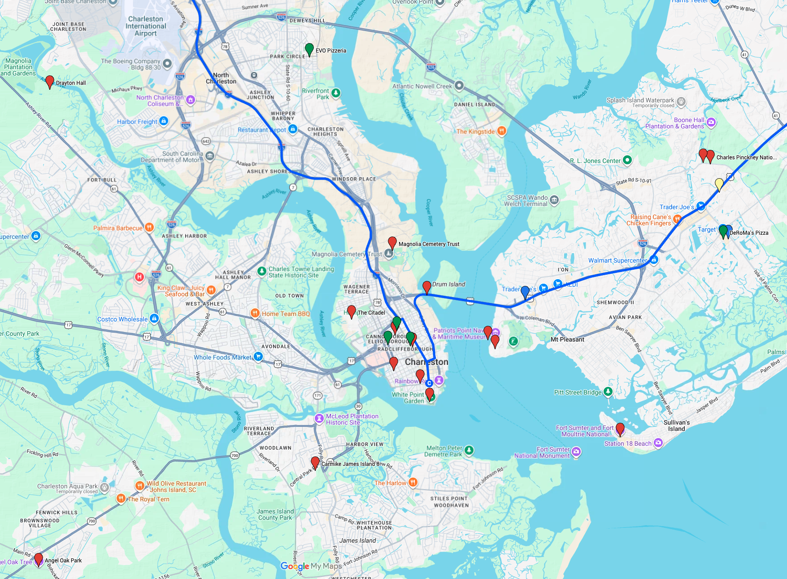

## Redwoods Tour

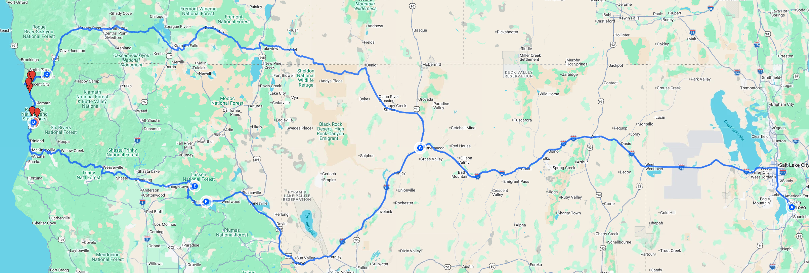

## Ian’s 13 year old trip Waterton Provincial Park

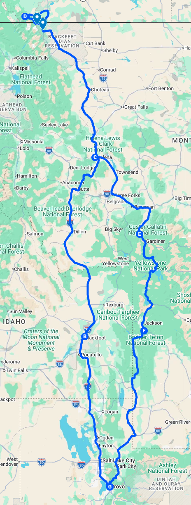

## Mckay’s 13 year old trip Grand Teton Circuit

## Dillon’s 13 year old trip

## Dillon's learning to drive trip

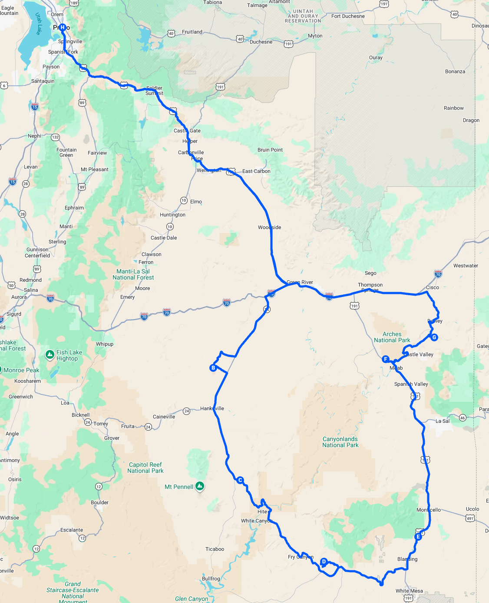

## Lizzie’s learning to drive trip

## Jeff and Claire's Wedding

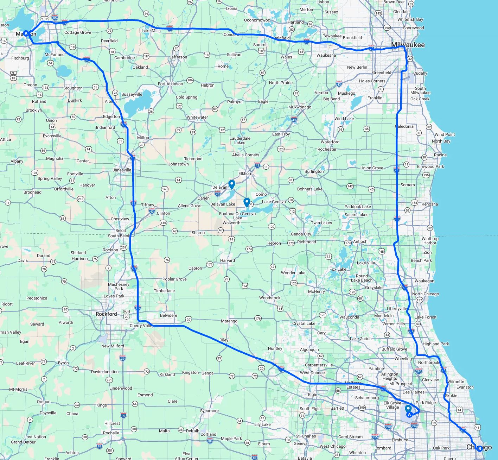

## Chicago Mckay Drop off

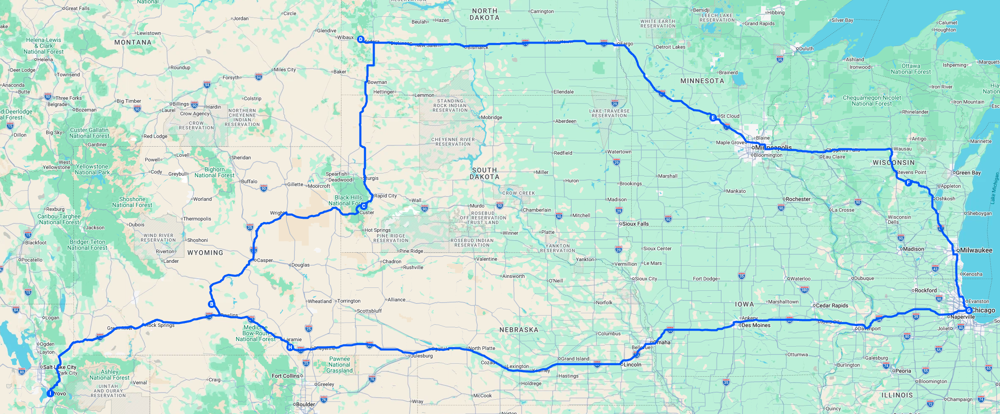

A multi-day trip with the following itinerary:

1. Day 1: Provo to Rawlins (5 hours)
2. Day 2: Rawlins to Custer (4.5 hours)
3. Day 3: Custer to Roosevelt (5.5 hours)
4. Day 4: Roosevelt to Sauk (6.5 hours)
5. Day 5: Sauk to Hartman (5 hours)
6. Day 6: Hartman to Chicago (3 hours)
7. Day 7: Chicago to Vedauwoo (14.5 hours)
8. Day 8: Vedauwoo to Provo (6.5 hours)

## Heart of America Tour

## Desertarama (San Rafael Swell, UT)

A multi-day adventure focusing on off-road riding and canyoneering, typically late May.

- **Key Locations:** Devils Racetrack, Goblin Valley (Color/Back of the Reef trails), Robbers Roost, Blue John Canyon (East/Main forks), and Lost Spring Canyon.
- **Gear:** Technical canyoneering gear (rope, harness) is required for slot canyons. Standard camping gear and ample water supplies are essential.

## Bryce National Park - Under the Rim Trail

## Red Canyon Bike Trail

## Cascade Loop

Distance: 26 miles
Elevation gain: 5000'
Comments: Long but really enjoyable. I would do it again.

I wanted to test my long distancing, high elevation gain, ability with something that would prepare me for my upcoming Sierra trip. I decided that hiking all around Cascade Peak in one day would do the trick. All Spring I looked the mountain and wondered if could do it. Finally, I decided to go for it. I started early at 5 AM and made great progress up Rock Canyon and then up to the Cascade Saddle. It was hard work with 4500' of elevation gain over 6.5 miles. The solitude was great and the views were beautiful. Once on the ridge I took a break and felt like the hard work was done. Never mind that I had another 20 miles yet to go.

The hike down to Big Springs went quickly, but was way steeper than I remembered. The road to the Provo River Trail and then to the Bonneville Shoreline Trail (BST) by Nunn's Park was a cruiser and actually really enjoyable. I then followed the BST back to my car at Rock Canyon.

I had lunch at Vivian Park and took trail snacks with me, but because I didn't spread out my caloric intake, food started to be hard to choke down and by the time I got to the Fairlawn Cemetery I was bonking a bit. The 90+ temperatures were not helping either especially with the direct sun shining on the shadeless trail. So I dowsed myself in the cemetery sprinkler that was watering the lawn, filled up my water bottles, and took a little nap under a pine tree. If that sprinkler hadn't been going I would have been in much worse shape.

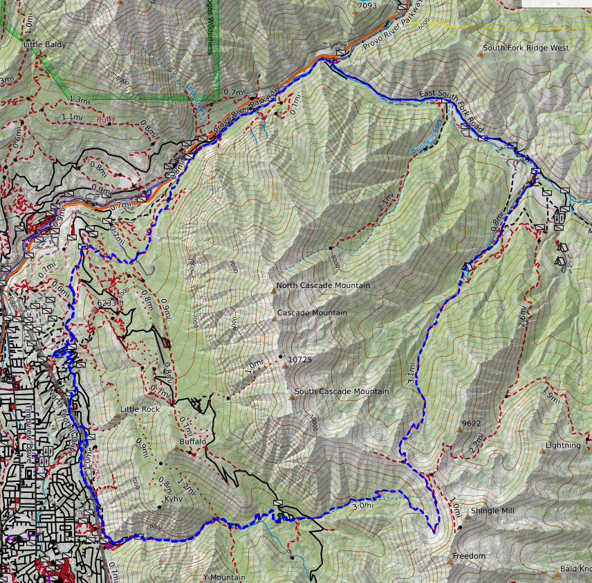

## High Sierra Half Evo via Haeckel Col

- distance: 35.18mi
- range: 8717' to 12665'
- gross: +8542'-8583'

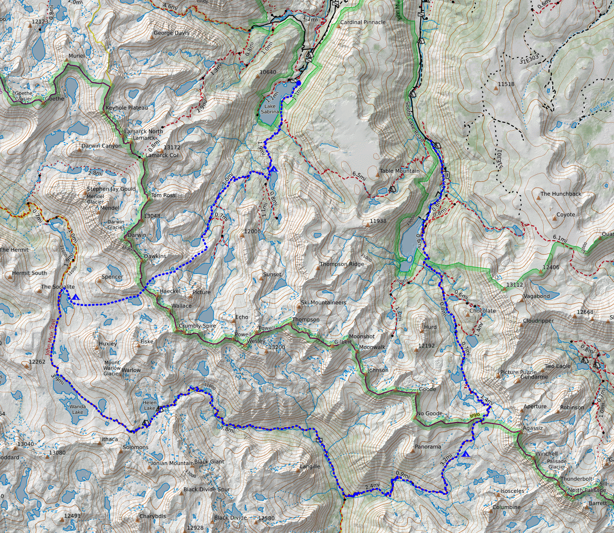

## Bike around Utah Lake

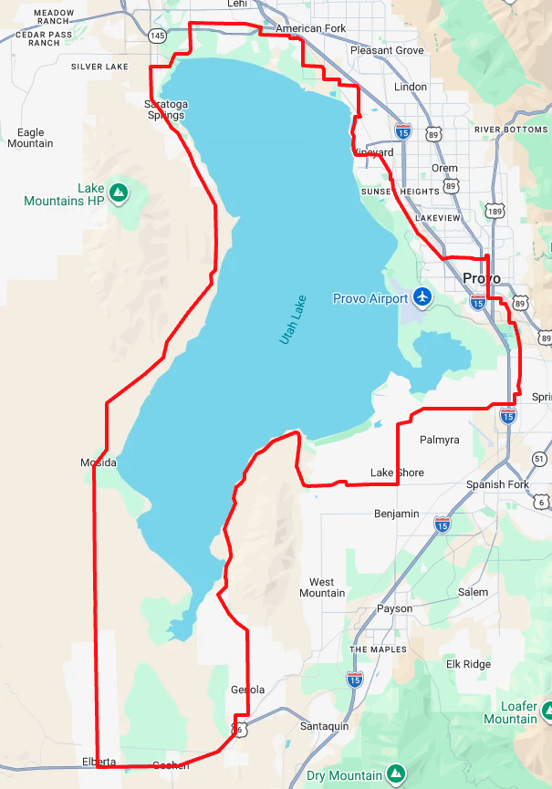

## Provo to Ogden on a Bike

## Box Elder Peak
